# Data Access Guide

The following is a demonstration of all our WSIs and patches using the region annotation platform that we developed. I have listed the steps below, with detailed instructions for viewing WSIs and patches.

## Steps for Viewing WSIs

1. Open the [sign-in page](https://mdi.hkust-gz.edu.cn/metal/user/#/sign-in).

   Enter the login account and password:

   - **Account:** **13600000021**
   - **Password:** **reviewer2025**
   - Then **click the blue "登陆" button** to proceed.

   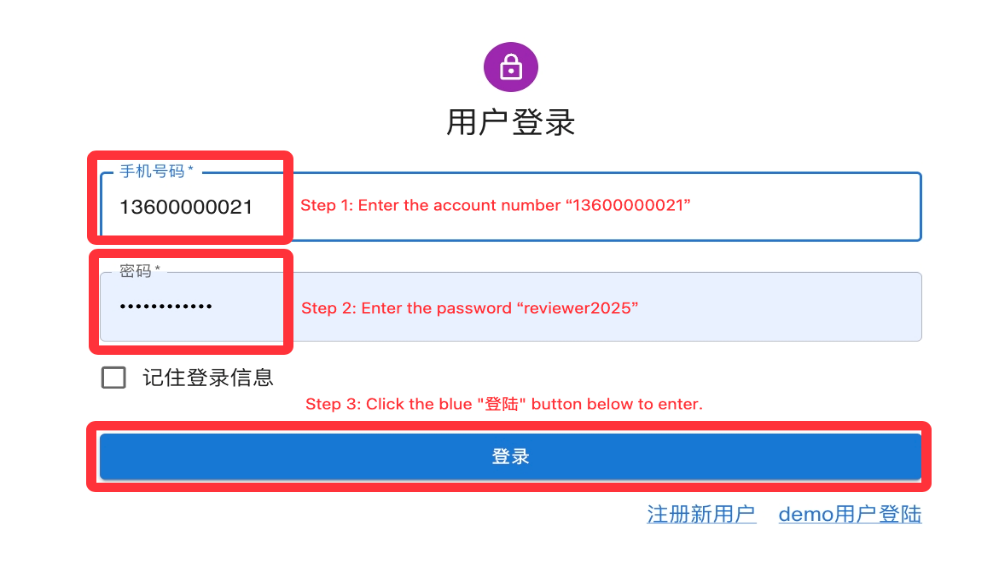

2. Then **click the "标注" button** to proceed.

   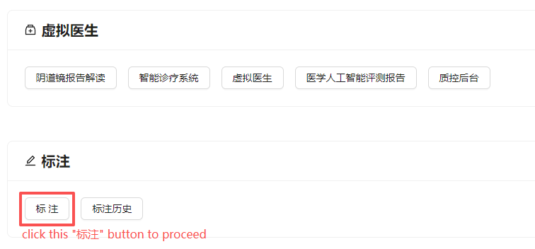

3. You can see the **WSIs in BPRBench** project. **Click the right "查看" button** to proceed.

   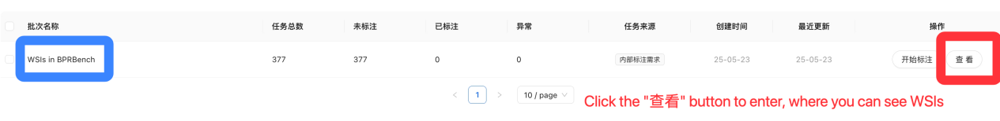

4. Each WSI has a corresponding "标注" button. **Click the "标注" button** to enter and view this WSI.

   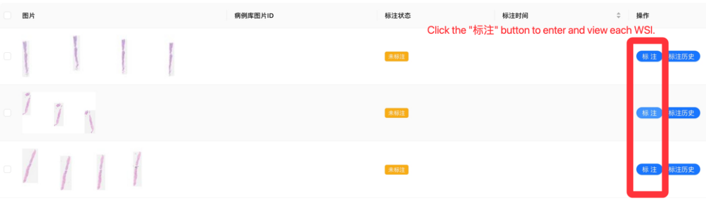

5. After entering a WSI, you can use the zoom tool in the top-right corner to view this WSI at different magnifications.

   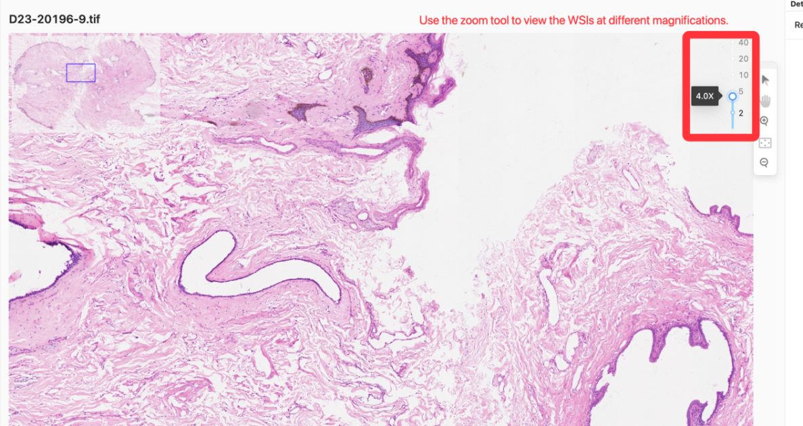

6. There are 10 WSIs displayed per page. You can click the page numbers below to view other WSIs.

   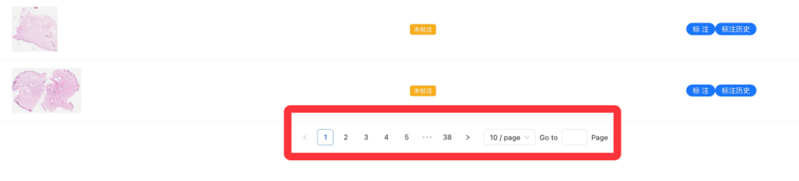

## Steps for Viewing Patches

1. Open the [sign-in page](https://mdi.hkust-gz.edu.cn/metal/user/#/sign-in).

   Enter the login account and password:

   - **Account:** **13600000020**
   - **Password:** **reviewer2025**
   - Then **click the blue "登陆" button** to proceed.

   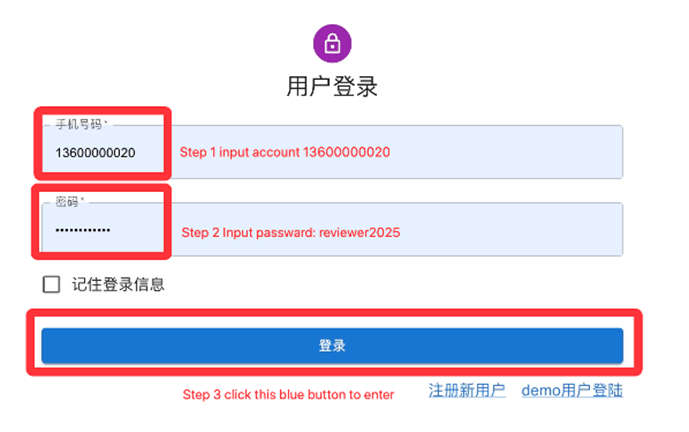

2. Then **click the "标注" button** to proceed.

   

3. On the left, you can see a list of folder names. On the right, you can **click the "查看" button** to enter and view the patches under this folder.

   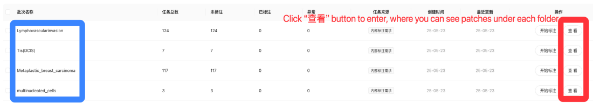

4. Each patch has a corresponding "标注" button. **Click the "标注" button** to enter and view this patch.

   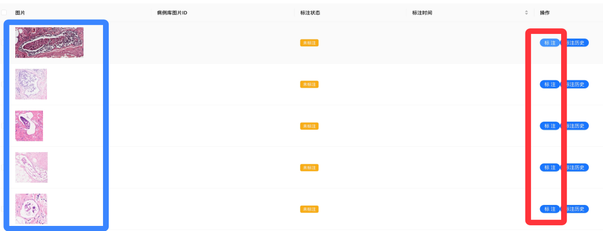

5. After entering a patch, you can use the "zoom-in" and "zoom-out" buttons in the top-right corner to zoom in and out of this patch.

   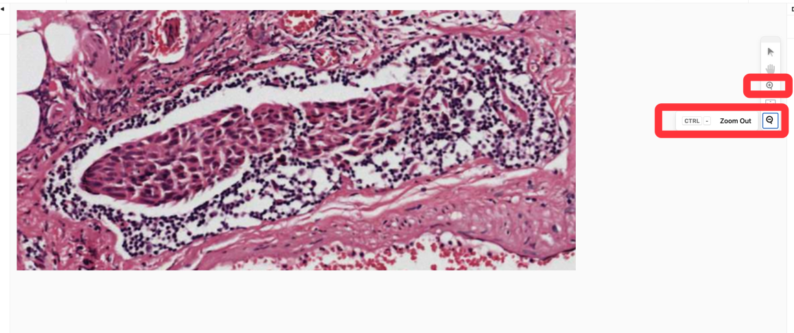

6. 10 folders are displayed per page. You can click the page numbers below to view other folders and their corresponding patches.

   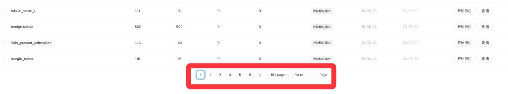

## Correspondence Between Options and Patches in Folders

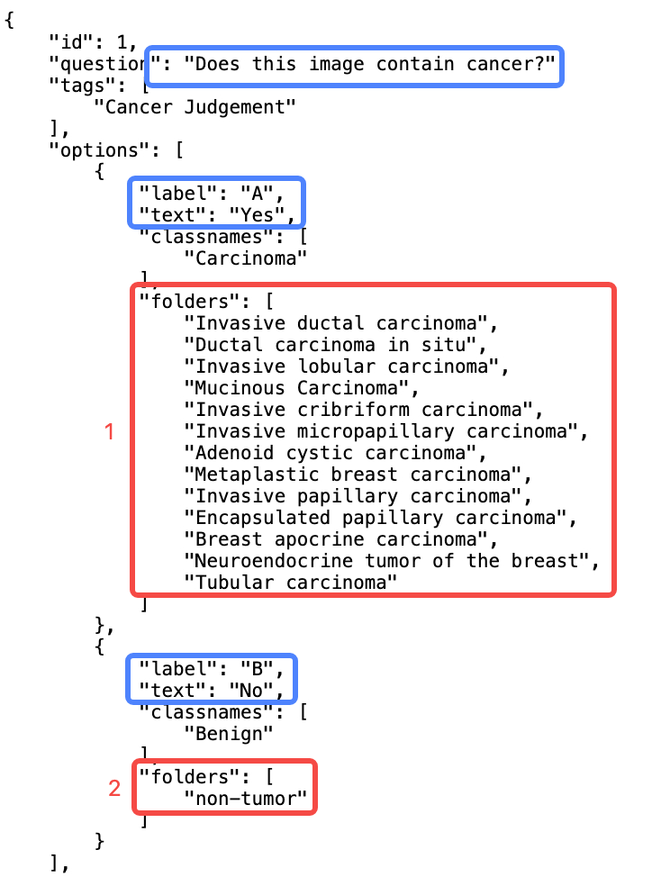

[question-to-patch mapping JSON](https://mdi.hkust-gz.edu.cn/static/question_with_prompt.json)

The provided JSON link offers correspondence between options and patches in folders.

For example, for **item 1**, the question related to MLLMs evaluation is: **"Does this image contain cancer?"**

- **Option A:** "Yes" - This option corresponds to the patches under the folders in **red box 1**.
- **Option B:** "No" - This option corresponds to the patches under the folder in **red box 2**.

Each option is associated with specific patches based on the folder structure outlined in the JSON file.
